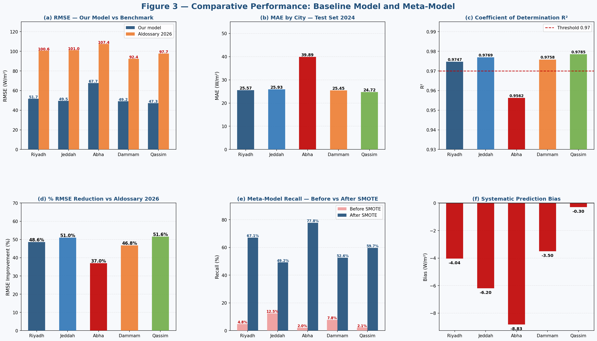
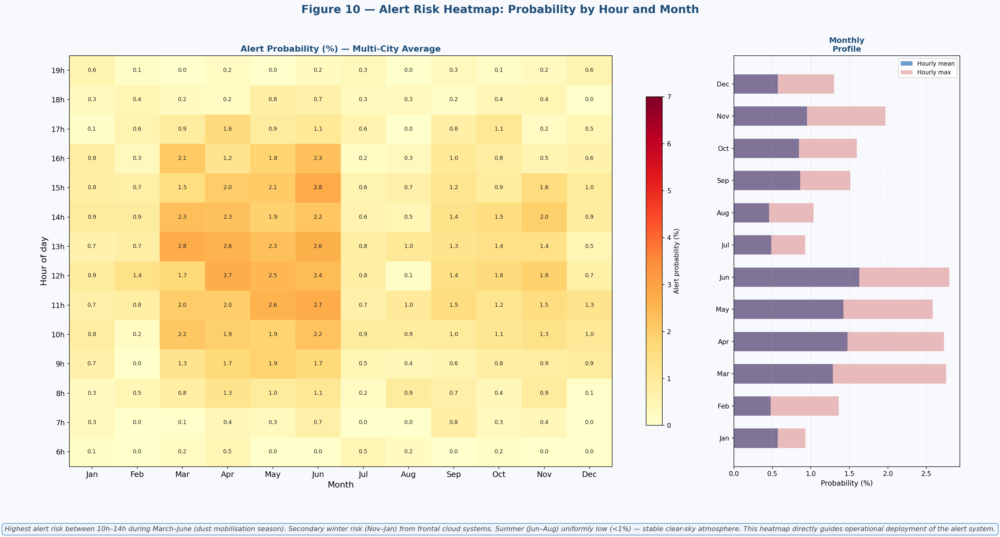

# Anticipatory Solar Irradiance Forecasting

Hourly forecasting of **Global Horizontal Irradiance (GHI)** for five Saudi cities (Riyadh, Jeddah, Abha, Dammam, Qassim), combined with a **meta-model that anticipates when the forecast is likely to be wrong**, so grid operators can be alerted before large errors happen.


## Approach

1. **Data**: hourly weather and irradiance data, 2019–2024, one file per city (`data/raw`).
2. **Feature engineering** (`data/processed`): time features, clear-sky ratio, a dust proxy, wind direction encoding (sin/cos), interaction terms, and 1 h / 3 h trends.
3. **Chronological split**: train / validation / test, with **2024 held out as the test year**.
4. **Baseline forecaster**: Random Forest regressor per city, predicting GHI.
5. **Meta-model (error anticipation)**: LightGBM classifier trained on the baseline's residuals (including lagged residuals) to predict an **alert** when a large forecast error is likely.

## Results (2024 test set)

Computed from the prediction files in `results/meta_improved/`.

| City | RMSE (W/m²) | MAE (W/m²) | R² |
|---|---|---|---|
| Riyadh | 51.7 | 25.6 | 0.975 |
| Jeddah | 49.5 | 25.9 | 0.977 |
| Abha | 67.7 | 39.9 | 0.956 |
| Dammam | 49.2 | 25.5 | 0.976 |
| Qassim | 47.3 | 24.7 | 0.979 |

Abha (mountain city, more variable cloud cover) is the hardest site. The alert model catches about 50–78% of the large-error hours depending on the city, with precision around 30–37%. That trade-off favours not missing critical hours.

## Repository structure

```
data/
  raw/                 # hourly data per city
  processed/           # engineered features + train/val/test split
models/
  *_baseline_rf.pkl    # Random Forest forecasters
  meta/                # LightGBM alert models
  meta_improved/       # improved LightGBM alert models
results/
  baseline/            # residuals of the forecaster
  meta/, meta_improved/  # alert predictions and per-city results
colab_all_figures/     # one notebook per paper figure + exported PNGs
```

## Figures

| Model comparison | Alert heatmap |
|---|---|
|  |  |

## Reproduce the figures

Open any notebook in `colab_all_figures/` (Google Colab or Jupyter) and run the cells in order.

<!-- TODO (Marwa): add the training / feature-engineering scripts or notebooks so the full pipeline can be reproduced, not only the figures. -->

## Author
Reda JELFA
Marwa Hanini · [LinkedIn](https://linkedin.com/in/marwa-hanini-9421663b5) · [GitHub](https://github.com/HANINIMarwa)
